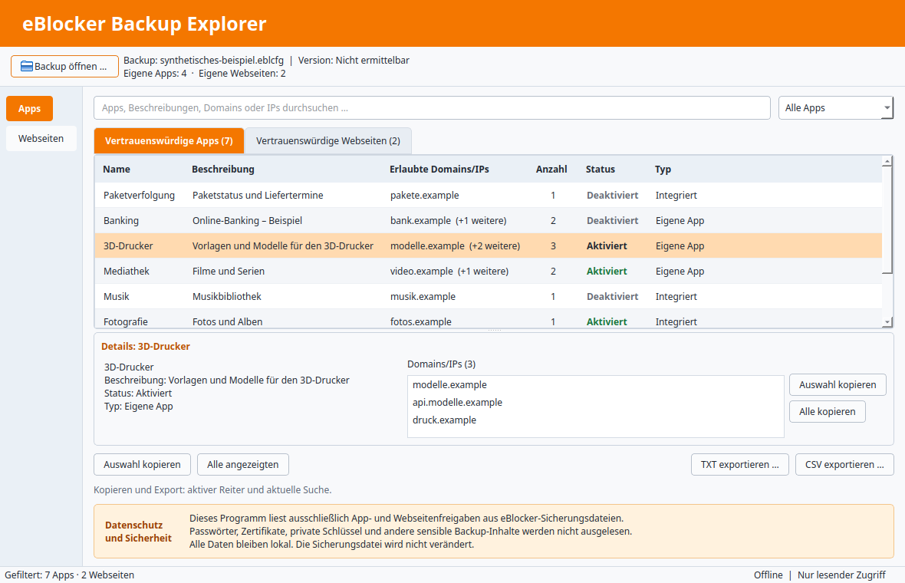

# eBlocker Backup Explorer 0.1.0

Eigenständige Desktop-Anwendung für eBlocker-App- und Webseitenfreigaben.
Python 3 und PySide6, vollständig lokal und ausschließlich lesender Backup-Zugriff.
Unabhängiges Community-Werkzeug: **kein offizielles Produkt des eBlocker-Projekts**.

Zielplattformen: Pop!_OS mit KDE/X11, Windows 11 (64 Bit) sowie macOS auf
Apple Silicon und Intel. **macOS-Unterstützung ist vorbereitet, aber ungetestet.**
Entwicklung und Quellcodeänderungen erfolgen ausschließlich unter Linux.
Windows und macOS dienen ausschließlich zur Installation und zum Testen.

## Funktionen

- `.eblcfg` über den nativen Qt-Dateidialog auswählen; keine automatische Dateiöffnung.
- Eigene und integrierte Apps unterscheiden; Name, Beschreibung, Domains/IPs,
  Anzahl und Aktivierungsstatus anzeigen.
- Einzelne Webseitenfreigaben separat darstellen, sofern das entsprechende Modul vorhanden ist.
- Sofortige Suche nach Namen, Beschreibung, Domain oder IP ohne Beachtung der Großschreibung.
- Vollständige, horizontal und vertikal scrollbar dargestellte Domainlisten.
- Einzelne oder mehrere Domains, Domains ausgewählter Einträge und alle angezeigten Domains kopieren.
- TXT (tabulatorgetrennt) und CSV in UTF-8 exportieren.
- Orange Kopfzeile, helle Tabellen und gut sichtbarer Datenschutzhinweis.

Kopieren und Export beziehen sich auf den aktiven Reiter und die aktuelle Suche.
Eine passende App zeigt und exportiert ihre vollständige Domainliste. Doppelte identische
Domains/IPs innerhalb einer App werden zusammengefasst. Der Export enthält nur Typ,
Name, Beschreibung, Status und freigegebene Domains/IPs. Vorhandene Dateien werden
nicht überschrieben. CSV-Zellen mit möglichen Formelanweisungen erhalten ein führendes
Apostroph. TXT und CSV maskieren Zeilenumbrüche und Trennzeichen korrekt.

## Unterstützte Backupformate und Versionsgrenze

Unterstützt wird das in beiden lokalen Referenzbackups beobachtete, unverschlüsselte
ZIP/JAR-Format mit `eblocker-config/appModules.json`. Unterschiedliche zusätzliche
Konfigurationsbereiche sind zulässig und werden nicht geöffnet.

Die Anwendung wurde laut Holgers Rückmeldung lokal mit eBlocker-Backups der
Versionen 4 und 5 erfolgreich getestet. Die automatische Versionserkennung bleibt offen.
Die untersuchten ZIP-Verzeichniseinträge und Kommentare enthalten keine eBlocker-Version.
`META-INF/MANIFEST.MF` wird aufgrund der strikten Lesebeschränkung nicht geöffnet.
Die GUI zeigt deshalb „Nicht ermittelbar (Datenschutzmodus)“. Eine zuverlässige automatische
Versionserkennung ist unter dieser Einschränkung noch offen. Es werden weder Versionsfelder
erfunden noch Datum oder ZIP-Formatversion als eBlocker-Version ausgegeben.

Details zum tatsächlich geprüften Schema: [docs/FORMAT.md](docs/FORMAT.md).

## Release-Pakete 0.1.0

Vorbereitete Quellpakete: `eBlockerBackupExplorer-0.1.0-Linux.zip`,
`eBlockerBackupExplorer-0.1.0-Windows-11.zip` und
`eBlockerBackupExplorer-0.1.0-macOS.zip`. Alle enthalten denselben Python-Quellstand,
Dokumentation, synthetische Tests und die Start-/Installationsskripte für alle Plattformen.
Keine EXE, keine PyInstaller-Paketierung, keine `.app`/`.dmg` und keine Backups.
Python und Drittanbieter-Wheels sind nicht enthalten. Linux/macOS benötigen daher
vor der Installation separat bereitgestellte Offline-Wheels; Windows lädt sie bei
`install.bat` von PyPI. `SHA256SUMS` dient der Kontrolle der drei ZIP-Dateien.

## Installation unter Linux

Voraussetzungen: Python ab 3.10, venv/ensurepip-Unterstützung und die Qt/X11-Systembibliotheken
(darunter `libxcb-cursor0`). Die Skripte ändern keine Systempakete oder Dienste.

Die Installation ist ebenfalls offline: Vorab bereitgestellte, zur Plattform und Python-Version
passende Wheels gehören in `wheelhouse/`. Benötigt werden `setuptools>=68`, `wheel`,
`PySide6>=6.6,<7` einschließlich `PySide6_Essentials`, `PySide6_Addons`, `shiboken6`
und deren Abhängigkeiten. Für Tests zusätzlich pytest und dessen Abhängigkeiten.
Es finden keine automatischen Downloads statt. Fehlen Pakete, bricht die Installation
mit einem Hinweis ab. Linux-Wheels sind nicht unter Windows verwendbar.

Im Projektverzeichnis:

```bash
bash install.sh
bash start.sh
```

Die Installation erstellt ausschließlich `.venv/` und installiert dort das lokale Projekt.
Sie ist wiederholbar; nach Quellcodeänderungen erneut ausführen. Der Start verwendet immer
diese Umgebung und installiert nichts. Direkter Start nach Installation:

```bash
.venv/bin/python -m eblocker_backup_explorer.main
```

Pfade mit Leerzeichen werden unterstützt. Bei Fehlern bleibt ein interaktiv gestartetes
Terminal bis zur Eingabetaste offen. Bei Qt-Startfehlern die Ausgabe im Terminal prüfen.
Ein AppImage ist für später vorgesehen, aber noch nicht erstellt.

## Installation und Start unter Windows 11

Windows wird ausschließlich als ZIP verteilt. Es gibt keine eigenständige EXE und
keine EXE-Buildskripte. Python ab 3.10 in **64 Bit** muss bereits verfügbar sein;
Python 3.12 x64 ist die für den ersten Praxistest empfohlene Ausgangsbasis.

1. `eBlockerBackupExplorer-0.1.0-Windows-11.zip` vollständig in einen
   beschreibbaren lokalen Ordner entpacken, beispielsweise im Benutzerverzeichnis.
   Nicht direkt aus der ZIP starten und nicht nach `Program Files` entpacken.
2. Im entpackten Ordner `eBlockerBackupExplorer` die Datei `install.bat` starten.
   Die Paketfassung erkennt Python über `py -3` oder `python`, erstellt eine lokale
   `.venv` und darf fehlende Abhängigkeiten von PyPI herunterladen.
3. Anschließend `start.bat` starten. Es verwendet ausschließlich
   `.venv\Scripts\python.exe` und installiert oder aktualisiert keine Pakete.
4. Bei Fehlern die angezeigte Meldung lesen; das Fenster bleibt offen.

Beide Skripte gehen vom eigenen Verzeichnis aus und unterstützen Leerzeichen im Pfad.
Wiederholte Installation ist möglich. Es werden keine Administratorrechte angefordert,
keine globalen Python-Pakete geändert, keine Registry-Einträge geschrieben und keine
systemweite Installation vorgenommen. Eine vorhandene Python-Installation wird vorausgesetzt;
das Paket installiert Python selbst nicht.

Der gemeinsame Installer erlaubt Downloads nur mit `--online`, wie es `install.bat`
explizit aufruft. Linux und macOS bleiben beim Offline-Verfahren mit `wheelhouse`.
Die Anwendung selbst ist auf allen Plattformen vollständig offline.

Keine Quellcodeänderungen unter Windows: Fehler dort erfassen, unter Linux korrigieren
und mit einem neu erstellten ZIP erneut testen. Laut Holgers Rückmeldung sind Installation, Start, Backup öffnen sowie Domains
anzeigen und kopieren unter Windows 11 erfolgreich praktisch getestet.
TXT-/CSV-Export ist unter Windows noch nicht praktisch getestet. Die neu vorbereitete
Release-ZIP wurde hier unter Linux geprüft; ein erneuter Windows-Test dieser ZIP steht aus.

## Installation und Start unter macOS (ungetestet)

Es wurde bislang kein echter Mac getestet. Die gemeinsamen Python-/PySide6-Module
werden unverändert genutzt; die Mac-Skripte prüfen lediglich die Startumgebung.
Native Qt-Dateidialoge bleiben aktiviert. Es gibt keine `.app`-/`.dmg`-Paketierung,
keine zusätzlichen Paketierungswerkzeuge und keine systemweite Installation.

### Voraussetzungen

- Vorhandenes Python ab 3.10 in 64 Bit mit `venv`/`ensurepip`, erreichbar als `python3`.
  Die Skripte installieren Python nicht und fordern keine Administratorrechte an.
- Ein beschreibbarer Projektordner im eigenen Benutzerverzeichnis.
- Zur Python-Version, Rechnerarchitektur **und macOS-Version** passende Wheels für
  `setuptools>=68`, `wheel`, `PySide6>=6.6,<7`, `PySide6_Essentials`, `PySide6_Addons`,
  `shiboken6` und deren Abhängigkeiten im lokalen Ordner `wheelhouse/`.
  Linux- oder Windows-Wheels sind hierfür nicht geeignet. Der vorhandene Linux-Wheelvorrat
  allein reicht deshalb nicht für einen Mac.
- Eine macOS-Version, die von den bereitgestellten Python-/Qt-Wheels unterstützt wird.
  Eine konkrete macOS-Mindestversion ist hier noch nicht praktisch verifiziert;
  inkompatible Wheels werden von pip abgewiesen.

| Mac | Python-Architektur | Benötigte Wheels |
| --- | --- | --- |
| Apple Silicon (M-Serie) | `arm64`, nativ | Für arm64 passende macOS-Wheels, ggf. `universal2` |
| Intel | `x86_64` | Für x86_64 passende macOS-Wheels, ggf. `universal2` |

Die Architektur des laufenden Python lässt sich im Terminal prüfen:

```bash
python3 -c 'import platform, struct; print(platform.machine(), struct.calcsize("P") * 8)'
```

Auf Apple Silicon soll dies `arm64 64`, auf Intel `x86_64 64` ergeben.
Rosetta-Betrieb wurde nicht getestet; die Skripte erkennen die Python-Prozessarchitektur,
nicht zuverlässig einen darunterliegenden Apple-Silicon-Rechner im Übersetzungsmodus.
Keine `.venv` von Linux, Windows oder einer anderen Mac-Architektur übernehmen.

### Ablauf im Terminal

Die Datei `eBlockerBackupExplorer-0.1.0-macOS.zip` vollständig entpacken.
Passende macOS-Wheels separat im Unterordner `wheelhouse/` bereitstellen.

```bash
cd "/Pfad mit Leerzeichen/eBlockerBackupExplorer"
bash install-mac.sh
bash start-mac.sh
```

Die Mac-Installation erfolgt **offline** aus `wheelhouse/`. Es werden keine zusätzlichen
Downloadfunktionen eingeführt. Fehlende Wheels, ungeeignetes Python und nicht ladbares
PySide6 werden verständlich gemeldet. Nach der Installation muss PySide6/Qt importierbar
sein. Vorhandene `.venv`-Umgebungen werden wiederverwendet, nicht automatisch gelöscht.
Nach Quellcodeänderungen `install-mac.sh` erneut ausführen.

`start-mac.sh` verwendet ausschließlich `.venv/bin/python`, prüft die lokale Python-/Qt-
Umgebung und startet die gemeinsame Anwendung. Es installiert nichts. Beide Skripte
arbeiten vom eigenen Verzeichnis aus und unterstützen Leerzeichen und Umlaute.
Fehler halten ein interaktiv gestartetes Terminal bis zur Eingabetaste offen.
Keine `sudo`-Aufrufe, Änderungen an globalen Python-Paketen, Diensten oder Backups.

### Noch erforderlicher Praxistest

Auf **Apple Silicon und Intel separat** prüfen: Installation zweimal, Start aus einem
anderen Verzeichnis, native Dateidialoge, Zwischenablage, Suche/Filter, lange Domainlisten,
TXT-/CSV-Export mit Umlauten, Retina-/Schrift-Skalierung, Über-Dialog und Beenden.
Nur synthetische Testdaten verwenden. Fehler unter macOS erfassen und ausschließlich
unter Linux beheben. Die Linux-Simulation ersetzt diese Prüfungen nicht.

## Datenschutz

Es wird ausschließlich der Inhalt von `eblocker-config/appModules.json` geöffnet.
Die ZIP-Inhaltsübersicht wird nur zur Auswahl dieses Eintrags verwendet. Kein anderer
Archivbestandteil wird geöffnet, analysiert oder exportiert, auch nicht das Manifest.
Passwörter, Zertifikate, private Schlüssel, HTTPS-Schlüsselmaterial, Geräte-, Netzwerk-,
DNS- und VPN-Einstellungen werden nicht ausgelesen.

Keine Netzwerkfunktionen, eBlocker-Verbindung, Telemetrie, Updates, Passwortdialoge,
Entschlüsselung oder Wiederherstellung. Keine Archivextraktion und keine Kopien vollständiger
Backups in temporären Dateien oder Logs. Keine Protokollierung persönlicher Freigaben.
Nur ausdrücklich ausgelöste Exporte schreiben neue Dateien. Die Zwischenablage wird nur
auf ausdrücklichen Kopierwunsch befüllt. Betriebssystemdienste wie die Zwischenablage
liegen außerhalb der Anwendung.

Echte Backups bleiben lokale Referenzen und gehören niemals in Git, Testfixtures,
Screenshots oder Veröffentlichungen. `.gitignore` und `MANIFEST.in` schließen relevante
Dateitypen aus; vor einer Veröffentlichung ist zusätzlich die Dateiliste zu prüfen.

## Tests

Ausschließlich synthetische Testdaten mit `.example`-Domains und Dokumentations-IP-Adressen.
Nach Bereitstellung der Offline-Testpakete:

```bash
.venv/bin/python -m pip --isolated install --no-index --find-links wheelhouse pytest
QT_QPA_PLATFORM=offscreen .venv/bin/python -m pytest -q
```

Windows, im Projektverzeichnis:

```bat
.venv\Scripts\python.exe -m pip --isolated install --no-index --find-links wheelhouse pytest
.venv\Scripts\python.exe -m pytest -q
```

GUI-Tests verwenden standardmäßig `offscreen`. Für einen echten GUI-Lauf die Variable
`QT_QPA_PLATFORM` auf `xcb` (Linux/X11), `windows` oder `cocoa` (macOS) setzen. Dateidialoge werden in den
automatisierten Tests ersetzt; native Dialoge müssen zusätzlich manuell getestet werden.
Prüfstatus und Plattformmatrix: [docs/TESTING.md](docs/TESTING.md).

## Bekannte Einschränkungen

- Automatische Unterscheidung eBlocker 4/5 noch offen, siehe Versionsgrenze oben.
- Keine Entschlüsselung; beschädigte, übergroße oder nicht passende Archive werden abgewiesen.
- Limits: 256 MiB Archivgröße und 16 MiB entpackte App-Daten.
- Nur im Backup vorhandene Module werden angezeigt. `enabledStates` allein enthält keine
  Namen oder Domains fehlender integrierter Apps; es wird kein Katalog nachgeladen.
- Webseiten werden anhand des beobachteten internen Moduls erkannt; eine eigene App mit
  nur einer Domain bleibt eine App. Veraltete `labels` erzeugen keine zusätzlichen Freigaben.
- Unbekannte Schemavarianten werden nicht durch geratene Felder interpretiert.
- Windows 11: Installation, Start, Backup öffnen, Domains anzeigen/kopieren laut Holger
  erfolgreich; TXT-/CSV-Export und erneuter Test der Release-ZIP noch offen.
- Native KDE-Dialoge und Linux-Systemzwischenablage noch nicht praktisch abgenommen.
- macOS (Apple Silicon und Intel) ist vorbereitet, aber bis zum echten Praxistest ungetestet.
- Große Archive werden synchron eingelesen; währenddessen kann die Oberfläche kurz warten.

## Screenshots

Die überarbeitete native Qt-Oberfläche orientiert sich an einer lokalen Bildvorlage,
die nicht zum Release gehört.
Suche und Filter stehen nebeneinander; kompakte Kopier- und Exportaktionen ersetzen
die früheren breiten Schaltflächen. Aktivierungszustände sind reine Textanzeigen.



Unter Linux mit Qt-Offscreen gerendert, kein KDE/X11-Praxisnachweis.
Weitere Vorschauen: [150 %](docs/screenshots/gui-linux-150.png),
[200 %](docs/screenshots/gui-linux-200.png).
Vergleich und Abnahmestatus: [GUI-Überarbeitung](docs/GUI-REVIEW.md).

## Projektstatus und GitHub

Geplantes Ziel: `Faber38/eBlockerBackupExplorer`, später öffentlich.
Das lokale Git-Repository existiert auf Branch `main`; es gibt noch keinen Commit.
Die GitHub-Veröffentlichung steht aus. In der Release-Vorbereitung wurden kein
GitHub-Repository angelegt, kein Push, Commit, Tag oder Release ausgeführt.

CMDRHelper wurde ausschließlich als Erfahrungsgrundlage für Startverhalten,
Umgebungstrennung, Qt-Skalierung und plattformspezifische Tests herangezogen.
Es wurden keine Dateien oder Komponenten daraus übernommen.

Lizenz: [MIT](LICENSE). Drittanbieter-Abhängigkeiten behalten ihre eigenen Lizenzen;
diese sind bei einer späteren Binärverteilung ebenfalls zu berücksichtigen.
